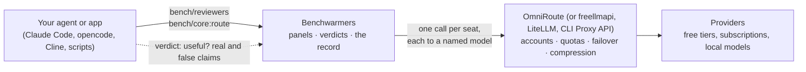

# How Benchwarmers compares

**Benchwarmers is not another gateway. It is the layer that finds out which of
your models is right.** Gateways such as OmniRoute, freellmapi, LiteLLM and
OpenRouter decide where a request goes by availability, quota, cost and speed.
Benchwarmers asks a panel of your models at once, keeps every answer labelled
by model, and records your (or your agent's) verdict on each one, down to which
claims were real and which were false. That record is what ranks the models
next time. It runs happily **on top of** a gateway: the gateway keeps the
accounts and the quotas, and Benchwarmers keeps the evidence.

Everything below about other projects comes from their own documentation or
source, read on 2026-11-20, with links under [Sources](#sources). Projects move
fast; if something here is out of date, please
[open an issue](https://github.com/WendellResearch-AI/benchwarmers/issues).

## Contents

- [The short answers](#the-short-answers)
- [At a glance: gateways and routers](#at-a-glance-gateways-and-routers)
- [At a glance: panels, arenas and evaluation](#at-a-glance-panels-arenas-and-evaluation)
- [Benchwarmers on top of OmniRoute (or any gateway)](#benchwarmers-on-top-of-omniroute-or-any-gateway)
- [One by one](#one-by-one)
- [What Benchwarmers does not do](#what-benchwarmers-does-not-do)
- [Sources](#sources)

## The short answers

**Is Benchwarmers just another OmniRoute?** No. OmniRoute is a gateway: one
endpoint for hundreds of providers that picks a model for each request and
falls back when one fails. Its "quality" signal measures whether the call
behaved (errors, rate limits, empty or cut-off output, latency). Benchwarmers
measures whether the answer was right, from verdicts on real work. Use both:
see [below](#benchwarmers-on-top-of-omniroute-or-any-gateway).

**Is it like LiteLLM or OpenRouter?** It speaks the same APIs (OpenAI, Anthropic,
Gemini, Ollama), and route mode gives agents one model per turn with failover,
like a router. The difference is what it is for: a panel of answers you can
compare, and a record of who was right.

**Is it like OpenRouter Fusion, OmniRoute's fusion or LLM Council?** They also
ask several models, and then they combine the answers into one. Benchwarmers
hands every answer back by default, because who said what is the evidence. A
merged answer is there when you ask for it (`bench/<collection>:merged`), with
every seat still listed.

**Is it like Open WebUI's arena?** Open WebUI rates answers with thumbs up or
down and builds a leaderboard. Benchwarmers' verdicts also say which claims
were false, they come from agents as well as people, and they rank the models
an agent is routed to, not just a leaderboard.

## At a glance: gateways and routers

✅ yes · 🟡 partly or differently · ❌ no or not documented

| | **Benchwarmers** | **OmniRoute** | **freellmapi** | **LiteLLM proxy** | **OpenRouter** |
|---|---|---|---|---|---|
| **What it is** | A panel gateway and a record of who was right | A free-model gateway: one endpoint, many providers | A free-model router: one `/v1` over free providers | A self-hosted LLM gateway | A hosted model marketplace and router |
| **One prompt to several models** | ✅ Every answer back, labelled by model and seat | 🟡 `fusion`: a panel, then a judge writes one answer | 🟡 `fusion`: drafts, then a judge writes one answer | 🟡 A list of models returns each response, or the fastest one | 🟡 Fusion: a panel, then a judge writes one answer |
| **Named group of models, called as one model** | ✅ Collections (`bench/<name>`) | ✅ Combos | 🟡 Profiles (`auto:<profile>`) | ✅ Model groups | 🟡 A fallback list per request |
| **Untried models get a turn** | ✅ Explorer seats: the least-used models rotate into every panel | 🟡 `auto/smart` routes 10% of requests to explore | ❌ | ❌ | ❌ |
| **A verdict on each answer** | ✅ Useful or not, with the real and false claims | ❌ Quality is how the call behaved; an evaluator hook exists, but we found nothing in its source that fills it | ❌ | ❌ | ❌ |
| **Verdicts change routing** | ✅ They rank members for agents (route mode) and build the "confidently wrong" record | ❌ | ❌ | ❌ | ❌ |
| **Tests on your own code** | ✅ Bugs planted in your own repositories, each with a clean control | 🟡 Eval suites you write; their pass rates can steer routing (opt-in) | ❌ | ❌ | ❌ |
| **Agents (tool calling)** | ✅ Route mode: one member per conversation, failover before the first token | ✅ | ✅ | ✅ | ✅ |
| **Agents judge the answers too** | ✅ MCP `ask`, `verdict` and `pending_verdicts`, and a Claude Code hook for unjudged answers | ❌ Many MCP tools, none for judging an answer | ❌ | ❌ | ❌ |
| **Dead models** | ✅ Daily probes; retired after one confirming call, with the evidence; restored in one click | 🟡 Circuit breakers exclude a failing model for a while | 🟡 Key health checks, cooldowns | 🟡 Cooldowns | 🟡 Provider health is part of routing |
| **Free-tier limits** | ✅ Read from providers' headers and errors, or set by hand; enforced before a call goes out | ✅ Free-tier catalog, quota pools across accounts | ✅ Per-key requests and tokens, a minute and a day | ✅ Requests and tokens a minute | Hosted: its own limits |
| **Providers** | Any OpenAI-compatible API or hub, plus Anthropic, Gemini and Ollama natively | 375 | 87 free providers | 100+ | Hundreds of models, hosted |
| **Runs** | Self-hosted; Python standard library only; MIT | Self-hosted; TypeScript and Next.js; MIT | Self-hosted; MIT | Self-hosted; MIT, enterprise parts under their own terms | Hosted |

## At a glance: panels, arenas and evaluation

| | **Benchwarmers** | **Open WebUI arena** | **LLM Council** | **deliberation** | **promptfoo** |
|---|---|---|---|---|---|
| **What it is** | A panel gateway with verdicts | A chat UI with an arena and a leaderboard | A local web app: models answer, review each other, a chairman sums up | An MCP server for second opinions and consensus | A test runner for prompts and models |
| **Several models, every answer kept** | ✅ Through any API client or agent | ✅ Side by side in chat | ✅ In tabs, then one final answer | ✅ Second opinions, a consensus vote | ✅ In a results table |
| **Who judges** | You, or the calling agent, per answer, with the real and false claims | You, thumbs up or down | The models, ranking each other anonymously | The models; it measures their agreement | Assertions and graders you write |
| **What the judgement changes** | Which member an agent gets next, and the model's record | A leaderboard | The chairman's answer | Advice on which models to drop | Your report |
| **New models rotate in on their own** | ✅ Explorer seats | 🟡 The arena picks from a pool you set | ❌ | ❌ | ❌ |
| **Your own code as the test** | ✅ Seeded from your repositories | ❌ | ❌ | ❌ | ✅ Any tests you write |
| **Usable as an API endpoint** | ✅ OpenAI, Anthropic, Gemini, Ollama formats | 🟡 An OpenAI-compatible API, one model a request | ❌ | ❌ MCP only | ❌ |

## Benchwarmers on top of OmniRoute (or any gateway)

The two do different jobs, so the best set-up uses both.

| Job | Who does it |
|---|---|
| Signing in to providers, pooling accounts, spreading quota | OmniRoute |
| Keeping one model's request alive (retries, account failover, compression) | OmniRoute |
| Asking several named models at once and keeping every answer | Benchwarmers |
| Rotating models you haven't tried into the panel | Benchwarmers |
| Recording who was right, and which claims were false | Benchwarmers |
| Choosing which model an agent gets, from that record | Benchwarmers |

**Setting it up:**

1. Run OmniRoute as usual (`http://localhost:20128`).
2. In Benchwarmers, **Endpoints** lists it under "Found on this machine" (as
   OmniRoute / 9router). Add it with an OmniRoute API key.
3. **Onboard the individual models** OmniRoute serves (a provider's model id,
   not a combo or `auto`), and put them in collections.

Seat individual models, not OmniRoute's combos or `auto`. A verdict is about
one model. If a seat is a combo, OmniRoute may answer with a different model
each time, and the record would be about nothing in particular. Within a
single model, OmniRoute's account failover and retries are welcome: they keep
that model's seat answering.

The same goes for freellmapi (`auto` profiles and `fusion` are its versions of
combos), LiteLLM (seat a deployment, not a group with fallbacks) and CLI Proxy
API (which Benchwarmers also finds on this machine).

## One by one

### Benchwarmers vs OmniRoute

- **OmniRoute is better at:** reaching providers (375, with sign-ins and account
  pools), keeping a request alive (22 routing strategies, circuit breakers,
  quota-aware fallback), token compression, shadow traffic, a desktop app and a
  VS Code extension, and a large community.
- **Benchwarmers adds:** every answer of a panel, labelled; a verdict per answer
  with its false claims; routing ranked by those verdicts; explorer seats;
  tests seeded from your own code; and MCP tools with which agents judge
  answers, not just send them.
- **Together:** OmniRoute underneath, Benchwarmers on top
  ([above](#benchwarmers-on-top-of-omniroute-or-any-gateway)).

### Benchwarmers vs freellmapi

- **freellmapi is better at:** a catalog of free providers and their keys, with
  live speed, capability and reliability scores that rank your chain.
- **Benchwarmers adds:** what the answers were worth, not just whether they
  came back. Benchwarmers also reads FreeLLMAPI's public catalog for its
  Discover page.
- **Together:** add freellmapi as an endpoint and seat its individual models.

### Benchwarmers vs LiteLLM

- **LiteLLM is better at:** production gateway features: cost tracking, load
  balancing across deployments, many routing strategies, guardrails, logging.
- **Benchwarmers adds:** panels, verdicts and the record. LiteLLM can return
  several models' responses to a list of models; it doesn't keep a judgement of
  them.
- **Together:** add the LiteLLM proxy as an endpoint (Benchwarmers finds it on
  this machine).

### Benchwarmers vs OpenRouter

- **OpenRouter is better at:** hundreds of models behind one hosted key, an Auto
  Router, fallbacks, and Fusion for one strong combined answer.
- **Benchwarmers adds:** your own record of which models were right on your
  work, kept on your machine, across OpenRouter and every other provider you
  use.
- **Together:** OpenRouter is one of the providers you can sign in to from the
  Endpoints page.

### Benchwarmers vs Open WebUI

- **Open WebUI is better at:** being a chat app for people: history, files, RAG,
  users, and an arena with a leaderboard.
- **Benchwarmers adds:** panels for apps and agents through an API, verdicts with
  claims, routing from them, health probes and pacing.
- **Together:** Benchwarmers can use Open WebUI as its hub (one connection, many
  providers), and Open WebUI can show a collection as a model through its
  Ollama connection.

### Benchwarmers vs LLM Council and deliberation

- **They are better at:** one considered answer. The models review each other
  and a chairman or a vote decides, which suits a decision you want made.
- **Benchwarmers adds:** a judgement from someone who can check the answer
  against the real code, which models agreeing with each other cannot give.
  Models fail together, so agreement is not proof. That judgement then shapes
  the next panel.

### Benchwarmers vs promptfoo, Inspect and other eval harnesses

- **They are better at:** repeatable test suites in CI, red teaming, graders.
- **Benchwarmers adds:** scoring that comes from your day-to-day work, not a fixed
  set, and new models rotating in on their own.

## What Benchwarmers does not do

- **It is not a hosted service.** It runs on your machine or your server.
- **It has fewer provider connections** than the big gateways. It connects to any
  OpenAI-compatible API, so put a gateway underneath for breadth.
- **A panel costs one call per seat.** That is cheap with free tiers, and slow
  when the slowest seat is slow.
- **Verdicts take checking.** The record is only as good as the verdicts, and a
  verdict means checking an answer against the real work. The MCP tools and
  the Claude Code plugin ask agents to do this, and to send each verdict.
- **Tools only through route mode.** A panel answers with text; agents with tools
  get one member per turn.
- **One install, one person at heart.** No teams or per-user views.
- **Young.** Version 1.0, from a small team. [Limits](README.md#limits) in the
  README has the rest.

## Sources

Read on 2026-11-20.

- OmniRoute: [README](https://github.com/cheaper-inference/OmniRoute),
  [routing strategies](https://github.com/cheaper-inference/OmniRoute/blob/release/v3.8.55/docs/routing/AUTO-COMBO.md),
  [adaptive routing](https://github.com/cheaper-inference/OmniRoute/blob/main/docs/architecture/ADAPTIVE_ROUTING.md),
  [quality signal source](https://github.com/cheaper-inference/OmniRoute/blob/main/open-sse/services/routing/quality.ts),
  [fusion source](https://github.com/cheaper-inference/OmniRoute/blob/main/open-sse/services/fusion.ts),
  [MCP server](https://github.com/cheaper-inference/OmniRoute/blob/release/v3.8.55/docs/frameworks/MCP-SERVER.md),
  [OmniCopilot](https://github.com/cheaper-inference/OmniCopilot)
- freellmapi: [README](https://github.com/tashfeenahmed/freellmapi)
- LiteLLM: [routing](https://docs.litellm.ai/docs/routing),
  [reliability](https://docs.litellm.ai/docs/proxy/reliability),
  [several models in one request](https://docs.litellm.ai/docs/proxy/user_keys)
- OpenRouter: [model routing](https://openrouter.ai/docs/features/model-routing),
  [fallbacks](https://openrouter.ai/docs/guides/routing/model-fallbacks.md),
  [Fusion](https://openrouter.ai/blog/insights/fusion-explainer/)
- Open WebUI: [evaluation and arena](https://docs.openwebui.com/features/administration/evaluation/)
- LLM Council: [README](https://github.com/karpathy/llm-council)
- deliberation: [README](https://github.com/antonbabenko/deliberation)
- promptfoo: [README](https://github.com/promptfoo/promptfoo)
- CLI Proxy API: [README](https://github.com/router-for-me/CLIProxyAPI)
