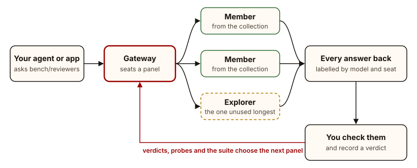

<h1 align="center">
  <picture>
    <source media="(prefers-color-scheme: dark)" srcset=".github/logo-dark.svg">
    
  </picture>
</h1>

  
  
  
  
   
  
  
  
  

<strong><em>Put me in, coach.</em></strong> Every model on your bench gets its minutes.

Benchwarmers is a self-hosted **panel gateway** for LLMs. Your app asks for one
of your **collections**, and the whole panel answers: the models you picked
for that kind of work, plus **explorer** seats that rotate in the models you
have used least. Every answer comes back side by side, labelled by model and
seat. You check them against the real work and record a verdict, and those
verdicts decide who sits on the next panel.

**What it is best at:**

- **Asking several models at once.** One OpenAI-compatible request, a panel of
  answers. Where they disagree is where to look.
- **Reviewing.** Code review, claims about code, designs: different models
  catch different things, and two models agreeing is not proof.
- **Playing to each model's strengths.** A collection per kind of work
  (reviewers, designers, enumerators), each with the models that do it best.
- **Giving every model playing time.** Explorers cycle through the rest of
  the bench, so new and free models get tried beside the ones you trust,
  without you choosing them by hand.
- **Benchmarking on your own projects.** A review suite seeded from your own
  repositories, plus your verdicts on real work, instead of public leaderboards.
- **Knowing who to bench.** Who is confidently wrong, who has stopped
  answering (retired automatically), and who is resting after a rate limit.
- **Keeping free and cheap models useful.** Health probes, learned rate limits
  and one endpoint for every app, over any OpenAI-compatible provider or hub.

| Related tools | Examples | What they do well | How Benchwarmers builds on it |
|---|---|---|---|
| Gateways and routers | LiteLLM, OpenRouter, Portkey | One OpenAI-compatible endpoint in front of many providers | The same endpoint, fanned out to a panel; LiteLLM and OpenRouter can sit behind it as a hub or an endpoint |
| Councils and ensembles | LLM Council, Mixture-of-Agents | Several models answer one question | Several models answer and every answer is kept; `:merged` adds one summary when you want it |
| Side-by-side chat | Open WebUI, LMArena | Answers next to each other, to compare | Side by side, then a verdict per answer that picks future panels; Open WebUI can be its hub |
| Evaluation harnesses | promptfoo, Inspect, SWE-bench | Score models on fixed test sets | A review suite from real bugs (SWE-rebench) and your own code, scored beside your verdicts on real work |

  <picture>
    <source media="(prefers-color-scheme: dark)" srcset=".github/flow-dark.svg">
    
  </picture>

## Contents

- [Try it](#try-it)
- [How it works](#how-it-works)
- [Asking a panel](#asking-a-panel)
- [The suite](#the-suite)
- [Docker](#docker)
- [What leaves your machine](#what-leaves-your-machine)
- [Limits](#limits)
- [Security](#security)
- [Development](#development)
- [Licence](#licence)

Day-to-day use (the dashboard's pages, connecting apps, onboarding in bulk) is
in [USAGE.md](USAGE.md). A coding agent setting it up for someone should start
with [AGENTS.md](AGENTS.md).

## Try it

**v0.1, early.** It runs from a checkout with Python 3.11 or later on Windows,
macOS and Linux, or in Docker. An installer (`pipx install benchwarmers`) is
still to come; until then, expect rough edges and read the code where these
pages are thin.

1. **Get the code** and a Python 3.11+ environment:

       git clone https://github.com/WendellResearch-AI/benchwarmers
       cd benchwarmers
       python -m venv .venv
       .venv/bin/pip install llm        # Windows: .venv\Scripts\pip install llm

   The [`llm`](https://llm.datasette.io/) CLI is the default model client today.
   The built-in client (`metrics/client.py`) replaces it, chosen on Settings
   or with `BENCH_CLIENT=builtin` (which wins), and will become the default.

2. **Make a data folder.** Everything that is yours (endpoints, model
   registrations, collections, verdicts, probe history, task answers) lives
   there, never in the code:

       python scripts/init.py           # or: python scripts/init.py <folder>

   It starts the folder from `examples/` (in your OS's per-user data folder
   unless you name one) and points the checkout at it with a
   `.benchwarmers-home` file; `BENCHWARMERS_HOME` overrides that. With
   `--endpoint NAME BASE_URL --key` it also adds a first endpoint and asks for
   its key, which goes to the `llm` CLI's key store (`llm keys set NAME` does
   the same), never into the data folder.

3. **Start the dashboard.** With no endpoint yet it opens on adding one: sign
   in with a provider on its own page (OpenRouter, NanoGPT, Hugging Face,
   Pollinations, your ChatGPT plan, GitHub Models, or a local Ollama), or paste
   an API key for any OpenAI-compatible API, a hub such as Open WebUI or
   LiteLLM included. Only providers that publish a sign-in for other apps are
   offered; adding one is an entry in `metrics/connect.py` (its docstring says
   how).

       python serve.py                  # http://localhost:8122

4. **Onboard a few models** from it ("Onboard a model"): tick one or several;
   each is registered, probed and run through the suite, one at a time, with
   the progress beside the button.

5. **Make a collection** on the Collections page (the models a panel always
   includes, and what it is for). The dashboard answers the gateway's routes on
   its own port (`http://127.0.0.1:8122/v1`); `python gateway.py` runs the
   gateway alone on `http://127.0.0.1:8123/v1`.

## How it works

- **Collections and seats.** A collection names the models a panel always
  includes and the shape of work it is for (review, design, enumeration...).
  Each call adds explorer seats chosen by how long a model has gone unused, so
  the bench keeps learning about models a router would stop asking.
- **Verdicts.** Each seat's answer carries a call id. Once you have checked an
  answer against the real work, record whether it was useful, and which of its
  claims were real or false. Verdicts, not vibes, decide the next panel; a
  model that is often confidently wrong shows as that.
- **The catalog.** Context window, output limit, tools, vision and price come
  from models.dev for the provider that actually serves a model, then
  OpenRouter's public catalog and FreeLLMAPI, and anything you set by hand.
- **Health.** Every morning each model gets a one-word prompt; once a week, a
  short and a long one for speed. A model that stops answering, or that its
  endpoint no longer serves, is retired automatically after one confirming
  call, with the evidence kept, and can be restored in one click. Rate limits
  are learned from providers' own error messages and kept per connection,
  since models behind one key share them. The built-in scheduler runs all of
  this once Settings switches it on; a fresh install spends no calls until then.
- **Discover.** models.dev and FreeLLMAPI, merged into one list of models
  worth adding, each with the routes this install has to it.

## Asking a panel

Any OpenAI-compatible client works: ask for the model `bench/<collection>`.

    curl http://127.0.0.1:8122/v1/chat/completions \
      -H "Content-Type: application/json" \
      -d '{"model": "bench/<collection>", "messages": [{"role": "user", "content": "Where can this function return a stale value? ..."}]}'

The reply carries every seat's answer in the message, and the same seats as
data in a `bench` field: model, seat, status, seconds and a call id. For a chat
window that shows one answer, ask for `bench/<collection>:merged`: a merger
model writes one answer saying where the seats agreed and disagreed, and every
seat is still in `bench`. Record a verdict per call once you have checked it:

    curl http://127.0.0.1:8122/bench/verdict -H "Content-Type: application/json" \
      -d '{"call": "<call id>", "useful": true, "note": "found the real bug", "real": ["..."], "false": ["..."]}'

or from the dashboard. See [GATEWAY.md](GATEWAY.md) for the full contract:
images, prompt sizes, who may call, and the reply's shape.

## The suite

Models are scored on review work: find the faulty line, or say whether a
claim about some code is true. The repository ships a starter pack:

- **Real bugs** (`suite/tasks/rebench-*`): recent fixes from public projects,
  drawn from the SWE-rebench-V2 dataset, each paired with a control.
- **Claims** (`suite/tasks/claim-*`): true and false statements about this
  project's own code, with the code attached.

Add your own from your repositories (`config/repos.json` in the data folder
maps a name to a folder): `python suite/seed.py --repo <name>` plants
realistic bugs in your real functions, each with a clean control. Private
code makes the best tasks, because no model has trained on it. See
[suite/README.md](suite/README.md), [suite/REBENCH.md](suite/REBENCH.md) and
[BENCHMARKS.md](BENCHMARKS.md).

## Docker

One container runs the dashboard, the gateway (on the same port, at `/v1`)
and the scheduler, with the data folder as a volume and no `llm` CLI (the
built-in client makes every call). Put the secrets in a `.env` file beside
`compose.yaml`:

    BENCHWARMERS_ADMIN_TOKEN=<16 or more characters>
    BENCHWARMERS_KEY_OPENROUTER=sk-or-...

then `docker compose up -d` and open http://127.0.0.1:8122. The compose file
publishes on this machine only; see its comments for a proxy.

## What leaves your machine

Benchwarmers has no account, no telemetry and no server of its own; nothing
reaches Wendell Research. What it sends, and where:

- **Your prompts**, only to the endpoints you add: a provider, an aggregator,
  a hub such as Open WebUI, or a local runtime. That includes the probes, the
  suite and onboarding, which spend calls on your keys. Add only endpoints you
  are content to send that work to.
- **Catalog reads**, no key and nothing of yours: models.dev and FreeLLMAPI
  once a day, and OpenRouter's public model list.
- **Sign-ins**, only when you choose one: the provider's own sign-in page.
- **Charts**: the dashboard's browser page loads Observable Plot from jsDelivr
  at a pinned version.
- **Seeding real-bug tasks**, only when you run `suite/rebench.py`: the
  SWE-rebench-V2 rows from Hugging Face and the files from GitHub.

Keys stay in the environment or the `llm` CLI's key store, never in the data
folder. [PRIVACY.md](PRIVACY.md) and [SECURITY.md](SECURITY.md) have the
detail.

## Limits

- **Early.** v0.1: no installer yet, no streaming replies, and the LiteLLM and
  CLI Proxy API hub adapters are built from those projects' source, not yet
  run against a real hub.
- **Calls cost.** Probes, onboarding and the suite run on your keys and free
  tiers. Onboarding runs one model at a time for that reason; a suite pass is
  paced, not burst.
- **One install, one person** at heart. Logins and gateway keys exist for a
  LAN or a server, but there are no per-user views or roles.
- **The onboarding queue lives in the dashboard's memory.** Restarting it
  drops the rest of a batch; each started model's log stays in `runs/`.
- **Free tiers change without notice.** Discover's prices come from public
  catalogs, and some providers' free models work only in their own app
  (switched per provider on Settings).

## Security

Both servers listen on 127.0.0.1 by default and accept only same-origin writes
for their own host name, so a web page in your browser cannot drive them. To
listen anywhere else, set `BENCHWARMERS_ADMIN_TOKEN` first; without it they
refuse to start. With it, the dashboard asks for a login and the gateway takes
named, revocable **gateway keys**. Settings, under Server and access, shows how
this stands (whether a secret is set, never its value).

[SECURITY.md](SECURITY.md) has the whole model and how to report a
vulnerability.

## Development

    python scripts/check.py             # every self-check and test (--quick skips the slow one)

The core is the Python standard library only. CI runs the checks on Linux and
Windows for Python 3.11 to 3.13, and on macOS.

Benchwarmers isn't taking outside contributions yet; that opens once it is
more established. A security problem goes through [SECURITY.md](SECURITY.md).

## Licence

MIT, Copyright (c) 2026 Wendell Research ([LICENSE](LICENSE)). The starter
tasks and bundled fonts carry their own licences, listed in [NOTICE](NOTICE).
Use is also covered by [TERMS.md](TERMS.md).
